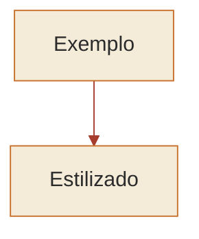

# Recursos visuais — camada compartilhada

> **Versão 1.4** · 2026-10-18 · artefato estável (D14/D20/D24)

Use junto com `metodo-professor` e a skill da disciplina. Padroniza os visuais de todos os professores: mesma identidade, mesmas ferramentas. **A prioridade é o aprendizado.** O visual existe para ancorar o ponto que está sendo explicado ou comentado — e, quando ancora, ele é bem-vindo com folga, não com parcimônia. O que ele **não** pode ser é varredura de capítulo ou enfeite vazio.

## Quando gerar

Duas fronteiras, só duas:

**Proibido (a trava do andaime):**
- **Varredura** — gerar visual proativamente para cobrir um tópico ou capítulo inteiro que ninguém pediu. Isso é a postura "otimização-primeiro" e fere a trava do `metodo-professor` (D1). O visual entra a serviço de um ponto em curso, não para mapear a matéria adiante.
- **Decoração** — visual que não ancora conceito nenhum. Um ícone bonito, um diagrama genérico "para ilustrar" sem carga didática. Se não fixa nada, não gere.

**Padrão (abundância a serviço do aprendizado):**
- **Dentro de uma explicação ou comentário já em andamento** — a pessoa travou num ponto, ou respondeu uma questão e você está comentando —, havendo gatilho legítimo, **gere por padrão, sem esperar pedido, sem pedir permissão e sem racionar.** Não pese "será que compensa o custo?": se o visual ancora o ponto, ele compensa. A prioridade é fixar o mecanismo.
- **Na dúvida entre texto e esquema, prefira o esquema.** Vários visuais numa mesma resposta são bem-vindos quando há vários pontos distintos a ancorar — respeitando "um conceito por visual" (quebre em chunks, não empilhe).
- **Disciplina declarada de alta dificuldade** (dial de suporte do `metodo-professor`): o visual por gatilho é o comportamento default, ainda mais forte.

**Gatilhos legítimos** (sempre a serviço do ponto sendo explicado/comentado — **um conceito por visual**):
- processo com fases/etapas → **fluxograma**
- hierarquia/classificação → **diagrama hierárquico**
- dois ou mais institutos que se confundem → **tabela comparativa**
- prazos/cronologia → **linha do tempo**
- **dois momentos no tempo que a questão confunde de propósito** (pagamento × consumo, venda × entrega, caixa × competência) → **linha do tempo com os dois eventos marcados**
- **decomposição numérica por partes** (lançamento contábil, equação patrimonial, rateio, apuração em etapas) → **esquema de caixas / razonete** (débito × crédito, cada grupo com seu Δ)
- princípio com desdobramentos/exceções → **mapa conceitual**
- proporções, índices ou comparações numéricas (ex.: índices de liquidez, repartição de receitas) → **gráfico**
- **o item afirma um estado** (saída impressa, valor de variável ao final, número de execuções, saldo após uma série de eventos) → **tabela de rastreio**: uma linha por iteração/etapa, uma coluna por variável, mais a coluna de saída. Registre **o estado final de tudo que a estrutura move, mesmo o que o item não perguntou** — é ali que costuma morar o item irmão da mesma prova
- **chamada que se aninha e volta** (recursão, sub-rotina dentro de sub-rotina, procedimento com retorno) → **pilha**: empilhamento descendo, desempilhamento subindo, com o valor devolvido em cada nível
- **estrutura indexada** (vetor, matriz, string por posição, tabela com posição relevante) → **grade com os índices nas bordas** — a borda é o que impede o erro de deslocamento de um
- **condição por faixas ou limites** (maior que × maior ou igual, intervalos encadeados, alíquotas progressivas, prazos com corte) → **reta numérica com os pontos de corte marcados**, mostrando de que lado cada limite fecha

Regra prática: se, **para o ponto em questão**, você ia escrever "primeiro… depois…", "A difere de B porque…", "divide-se em X, Y e Z" ou "de um lado entra, do outro sai", o visual ancora melhor — então gere. Só não expanda para além daquele ponto.

**Visual e cartão dividem o ponto, não competem (D24).** Um mesmo ponto costuma ter as duas coisas dentro: a **mecânica**, que se entende e se ancora em visual, e a **etiqueta arbitrária** dentro dela, que só se sabe de cor e vira cartão. A tabela comparativa de dois institutos que se confundem ancora *por que* eles diferem; o par de nomes que se troca é cartão. Quando você gerar visual num ponto que contém etiqueta arbitrária, **sinalize o cartão junto** — quem redige e grava é a `analise-desempenho`.

O que não vale: **cartão não substitui visual, e visual não substitui cartão.** Cartão que tenta carregar a mecânica inteira vira parede de texto que ninguém revisa; visual que tenta fixar uma lista arbitrária vira decoração, proibida pela primeira fronteira desta seção.

## Dois públicos: ancorar × instrumentar (D20)

Antes de desenhar, decida **quem vai usar aquilo**.

| | **Visual de ancoragem** | **Visual-instrumento** |
|---|---|---|
| Quem usa | o aluno **lê** | o aluno **redesenha à mão**, na folha de rascunho, sob pressão de prova |
| Projeto | Design System livre — pergaminho, cor, HTML/SVG, layout amplo | cabe em **A4**; **cor nunca carrega informação**; sem dependência de layout ou software; reproduzível a lápis em poucos traços |
| Exemplos | linha do tempo comentada, mapa conceitual, tabela comparativa rica | tabela de rastreio, grade de vetor com índices, pilha de chamadas, razonete em T, reta numérica |

Ao ensinar um instrumento, **ensine o traço, não só o resultado**: quantos riscos, em que ordem, o que se escreve em cada campo. E diga que é para reproduzir na prova — instrumento que o aluno não sabe que é instrumento vira figura bonita.

Técnica que só funciona colorida ou renderizada **é ilustração de ancoragem, não instrumento** — apresente como tal, sem prometer que serve de rascunho. Se um instrumento usar cor, a cor é redundante: o mesmo dado tem de estar legível em traço, posição ou rótulo.

**O catálogo de instrumentos é da disciplina, não daqui.** Esta skill define a restrição de projeto; qual instrumento serve a que estrutura (traço de execução em Lógica, razonete em Contabilidade, esquema de camadas em Redes) mora na skill da disciplina.

## Catálogo (tipo → ferramenta)

Mermaid para fluxo/estrutura/cronologia/mapa (renderiza inline); HTML/SVG estilizado para tabelas comparativas e esquemas de caixas (controle visual total).

- **Fluxograma** (processo/etapas: fases da licitação, ciclo da despesa pública) → Mermaid `flowchart`
- **Diagrama hierárquico** (pirâmide de Kelsen, estrutura da Administração, grupos do Balanço/PCASP, classificação de atos) → Mermaid `flowchart TD`
- **Tabela comparativa** (institutos/contas que se confundem: anulação × revogação, competência × capacidade, regime de caixa × competência) → **HTML/SVG estilizado** — é o visual mais cobrado
- **Linha do tempo** (prazos processuais, prescrição × decadência, transição da reforma, pagamento × consumo) → Mermaid `timeline`
- **Esquema de caixas / razonete** (lançamento D/C, variação por grupo A = P + PL, fluxo de valores entre contas) → **HTML/SVG estilizado**
- **Mapa conceitual** (um princípio central + desdobramentos e exceções) → Mermaid `mindmap`
- **Gráfico** (proporções, índices, comparação numérica) → Mermaid `xychart-beta` ou HTML/SVG
- **Tabela de rastreio** (execução passo a passo: iteração × variáveis × saída) → **HTML/SVG estilizado** — *instrumento*
- **Pilha** (recursão, aninhamento com retorno) → **HTML/SVG estilizado** — *instrumento*
- **Grade indexada** (vetor, matriz, string por posição, com índices nas bordas) → **HTML/SVG estilizado** — *instrumento*
- **Reta numérica** (faixas, limites, pontos de corte) → **HTML/SVG estilizado** — *instrumento*

## Design System (tokens fixos — use SEMPRE)

**Tipografia:** títulos `Playfair Display` (serif); rótulos/dados técnicos `DM Mono`; corpo `Figtree` (sans-serif).

**Paleta:**

| Função | Hex |
|---|---|
| Fundo (pergaminho) | `#F4ECD8` |
| Texto principal | `#2B2B2B` |
| Acento (laranja-terra) | `#C8702A` |
| Destaque/atenção | `#A63D2E` |
| Bordas suaves | `#D8C9A8` |
| Verde "correto/positivo" | `#5B7A3A` |

**Mermaid** — aplique o tema via bloco `init` no topo do diagrama:

**HTML/SVG** (tabelas e esquemas) — fundo `#F4ECD8`, cabeçalho `#C8702A`, título em `Playfair Display`, célula de pegadinha destacada em `#A63D2E`. O aluno revisa em **tablet e PC** (telas largas): pode usar layout amplo, colunas lado a lado, tabelas com várias colunas quando o conteúdo pedir — não há restrição de largura.

## Regras inegociáveis

1. **Aprendizado > economia.** Se um visual ancora o conceito, gere-o — não racione por custo nem por "será que precisa". A parcimônia se aplica só à varredura e à decoração, não ao visual que fixa o ponto.
2. **Conteúdo > enfeite.** Ancorar um conceito é a única justificativa. Enfeite sem carga didática não entra.
3. **Fidelidade à fonte/norma.** Nunca crie etapa, prazo, hierarquia ou lançamento que não exista na lei/norma/material — visual errado fixa erro.
4. **Destaque a pegadinha.** Marque com `#A63D2E` a célula/nó que a banca mais explora (conecta com a mineração de sinais do `metodo-professor`).
5. **Um conceito por visual.** Não empilhe três temas num diagrama — quebre em vários (chunks). Vários visuais numa resposta é ótimo; visual poluído com temas misturados, não.
6. **Coesão.** Todos os visuais usam o mesmo Design System. Nada de cores/fontes aleatórias.
7. **Priorize o esquema da fonte.** Se a apostila já traz um gráfico/esquema do ponto, baseie-se nele (reproduza fiel ou faça uma versão aprimorada).
8. **Contraste e legibilidade.** Nunca texto claro sobre fundo claro (ilegível — erro a evitar sempre). Fonte confortável, hierarquia visual clara.
9. **Autocontido — em duas dimensões.**
   - *Técnica:* HTML/SVG de estudo não depende de recurso externo (sem CDN, sem fonte remota, sem script de fora). Se a tipografia do Design System não carregar, degrade para serif/mono/sans-genéricas — nunca quebre o visual.
   - *De contexto:* o visual precisa fazer sentido **lido sozinho, semanas depois, longe do chat**. Todo visual gerado dentro de um comentário de questão carrega, junto do diagrama: **identificação** da questão (banca-ano-órgão **e o ID da fonte, quando o cabeçalho o trouxer** — o código do caderno de questões), **resumo do enunciado ou da situação** em uma ou duas linhas (nomes e valores do caso incluídos) e **o que o visual decide** (a regra de ouro ou o ponto exato que a questão confundia). Sem isso o arquivo nasce órfão: só funciona acoplado à conversa que o gerou, e o aluno salva um diagrama que não sabe mais para que serve. Vale também para visual de explicação: se ele nasceu de uma dúvida concreta, a dúvida vai junto em uma linha.

   O **ID é o ponteiro de volta**: identificação diz de onde o visual veio, o ID permite **reabrir o enunciado** — que é o que falta justamente quando o material se relê semanas depois. Fronteira: vale só para visual de **origem única**; esquema conceitual, hierarquia e comparação geral não têm o que citar, e inventar procedência é pior que não ter (D8). Campo ausente no cabeçalho fica ausente — nunca se completa de memória.
10. **Hipótese não entra em visual.** Afirmação sobre o mecanismo do erro do aluno — o diagnóstico, o carimbo do padrão, "é reincidência de X", a contagem de uma regra já consolidada — só é desenhada **depois** de o aluno confirmar. Enquanto for hipótese, ela vive no texto, em forma de pergunta. O motivo é a força do suporte: o visual fixa mais que a prosa e é o que sobrevive à conversa, então carimbo errado desenhado vira carimbo errado memorizado — e ainda ganha ar de veredito, o que desestimula a correção que só o aluno pode fazer. Isto **não** restringe o visual de conteúdo: o mecanismo da matéria, o traço da execução, a comparação entre institutos saem normalmente, na hora. A trava incide só sobre a afirmação a respeito de **por que o aluno errou**.
11. **Sequência de eventos vai numerada e com legenda.** Todo visual que mostra eventos encadeados — lançamentos, etapas, movimentos no tempo — numera cada evento **dentro** do desenho, em ordem cronológica, e traz **abaixo** uma legenda com uma linha por número: o que aconteceu, a operação realizada, o efeito e o valor ou estado resultante. Cabeçalhos de coluna e de eixo dizem o **efeito**, não só o rótulo. Momentos diferentes nunca se juntam num visual sem numeração: ou um visual por momento, ou um visual só com a numeração atravessando todos. **Os campos de cada linha da legenda são da disciplina** — em Contabilidade, a ficha da conta e a legenda do razonete estão na `contabilidade-geral`. Na versão **instrumento** (D20), o aluno leva só a numeração; a legenda é do visual de ancoragem. Motivo: rótulo curto preso a um número só funciona para quem já domina a mecânica, e para quem está construindo-a o visual vira um amontoado de valores — a refação custa mais que a legenda.
12. **Contagem conferida antes de entregar.** Visual que mostra quantidade — elementos desenhados, posições, linhas, valores, totais — é conferido **elemento por elemento** contra o número afirmado no comentário e na legenda antes de sair. Desenho que contradiz o próprio texto é pior que desenho nenhum: o aluno copia o desenho, e a confusão dura até ele achar a divergência sozinho.

## Saída

Exporte como **SVG** (vetorial, cola limpo em Word, Google Docs e Obsidian). Ao gerar, avise em uma linha que o visual pode ser baixado/copiado.

**Confirmação de escopo — só para artefato GRANDE:** antes de HTML interativo, documento de várias páginas ou evolução iterativa de um artefato, confirme escopo **antes** de executar — não presuma o pedido. **Isso NÃO se aplica** a diagrama, tabela, linha do tempo, razonete ou esquema inline dentro de uma explicação ou comentário: esses saem por padrão, à vontade, sem perguntar. A confirmação existe só para o esforço grande de construção, nunca como freio ao visual didático inline.

## Histórico de versões

| Versão | Data | Mudança |
|---|---|---|
| 1.4 | 2026-10-18 | Duas regras inegociáveis novas, de campo. **Regra 11** (fricção 43): sequência de eventos sai numerada dentro do visual, com legenda por número (fato, operação, efeito e valor) e cabeçalho com o efeito; os campos da legenda são da disciplina (em Contabilidade, na `contabilidade-geral` 1.3); na versão instrumento (D20), só a numeração. **Regra 12** (fricção 42): contagem do desenho conferida elemento por elemento contra o total afirmado no comentário. |
| 1.3 | 2026-08-27 | Duas entradas, mesma abertura. **Coemissão visual + cartão (D24):** um ponto costuma ter mecânica (visual) e etiqueta arbitrária (cartão) dentro; gerando visual num ponto assim, sinalizar o cartão junto — sem que um substitua o outro. **ID da questão de origem na regra 9** (L12): o ponteiro de volta que permite reabrir o enunciado semanas depois, quando o cabeçalho o trouxer, restrito a visual de origem única e sem completar procedência de memória. |
| 1.2 | 2026-08-04 | **D20** (seção "Dois públicos": visual de ancoragem × visual-instrumento, com a restrição de projeto do que o aluno redesenha à mão) · quatro gatilhos novos de execução e estrutura (tabela de rastreio, pilha, grade indexada, reta numérica) com as entradas correspondentes no catálogo · regra 10 (hipótese diagnóstica não entra em visual antes da confirmação). |
| 1.1 | 2026-07-21 | Nota 1 do Bloco A: regra 9 (autocontido) desdobrada em duas dimensões — técnica e de contexto (visual de questão carrega identificação, resumo da situação e o que resolve). |
| 1.0 | — | Versão inicial: Design System pergaminho, catálogo de tipos de visual, postura de abundância (D13). |
